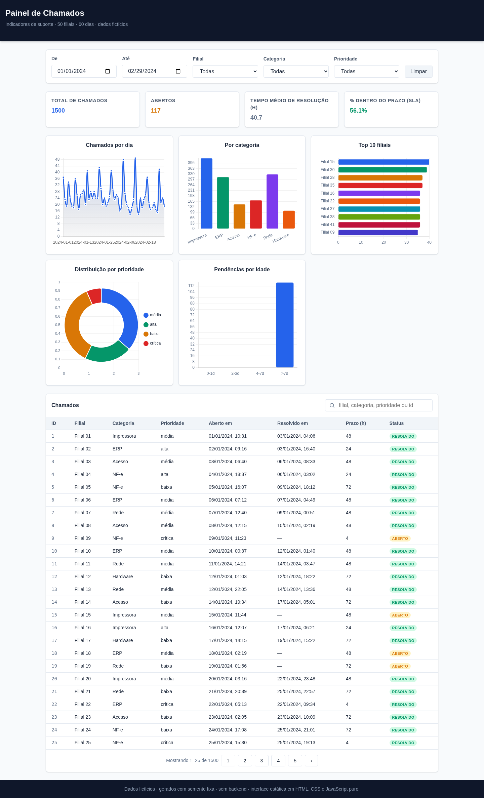
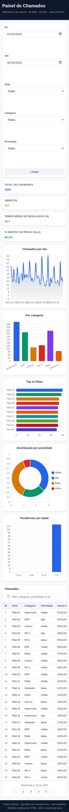

# Painel de Chamados

> **Status: concluído.** Interface completa com KPIs, gráficos, filtros e tabela.

## O que é

Painel web com os indicadores de uma operação de suporte fictícia: 50 filiais, 60 dias e cerca de 1.500 chamados. Mostra volume, tempo médio de resolução, cumprimento de prazo (SLA) e pendências, com filtros interativos.





## O que prova

JavaScript com dados (filtro, agregação, datas), visualização com Chart.js e entendimento dos indicadores de suporte.

## Stack

HTML, CSS, JavaScript (ES modules) e Chart.js 4. Script Node para gerar os dados. Publicação em GitHub Pages.

## Estrutura

```
painel-chamados/
├─ index.html
├─ css/estilo.css
├─ js/
│  ├─ dados.js        # carrega e normaliza o JSON
│  ├─ filtros.js      # período, filial, categoria, prioridade
│  ├─ kpis.js         # funções puras de cálculo
│  ├─ graficos.js     # Chart.js 4
│  ├─ tabela.js       # lista com busca, ordenação, paginação
│  └─ main.js         # orquestração
├─ data/chamados.json
├─ tools/gerar-dados.js   # gerador com semente fixa
├─ tests/
│  ├─ kpis.test.js
│  └─ filtros.test.js
└─ docs/              # screenshots para o README
```

## Como rodar

Requer Node.js 20+.

```sh
# instalar (nenhuma dependência de produção)
npm install

# gerar os dados (já versionados, roda determinístico)
npm run gerar

# executar os testes
npm test

# servir localmente (precisa de servidor por causa do fetch)
python3 -m http.server 8080
# ou: npx serve .
```

Abra `http://localhost:8080` no navegador.

## Indicadores e fórmulas

As fórmulas exatas estão no cabeçalho de `js/kpis.js`.

| Indicador | Fórmula |
|-----------|---------|
| **Total** | Quantidade de chamados no conjunto filtrado. |
| **Abertos** | Quantidade com `status === 'aberto'`. |
| **Tempo médio de resolução (h)** | Soma das horas entre `aberto_em` e `resolvido_em` dos resolvidos, dividida pela contagem de resolvidos. Retorna 0 se nenhum resolvido. |
| **% Dentro do prazo (SLA)** | `resolvidos_no_prazo / (resolvidos + abertos_vencidos) × 100`. Um chamado resolvido conta como "no prazo" se `resolvido_em - aberto_em ≤ prazo_horas`. Um chamado aberto conta como "vencido" se `agora - aberto_em > prazo_horas`. Abertos ainda dentro do prazo ficam fora do denominador. |
| **Pendências por idade** | Chamados abertos agrupados em faixas de dias completos desde a abertura: 0–1, 2–3, 4–7, >7 dias. |

## Gráficos

1. **Chamados por dia** (linha) — volume diário pela data de abertura.
2. **Por categoria** (barras) — contagem por categoria.
3. **Top 10 filiais** (barras horizontais) — filiais com mais chamados, desempate por nome.
4. **Distribuição por prioridade** (rosca) — crítica, alta, média, baixa.
5. **Pendências por idade** (barras) — 0–1d, 2–3d, 4–7d, >7d.

Todos usam `Chart.update()` para transições suaves sem recriar instâncias.

## Filtros

- **Período** (de / até) — inclui ambos os limites, pela data UTC de abertura.
- **Filial** — seleção única.
- **Categoria** — seleção única.
- **Prioridade** — seleção única.
- **Busca na tabela** — filtra por ID, filial, categoria ou prioridade.

Mudar qualquer filtro recalcula KPIs, gráficos e tabela ao mesmo tempo, sem recarregar a página. Os números dos cartões batem com a contagem da tabela filtrada.

## Estados da interface

- **Carregando** — indicador amarelo enquanto o JSON é baixado.
- **Erro** — indicador vermelho se o fetch falhar (ex.: arquivo ausente, HTTP 404).
- **Pronto** — indicador verde breve, depois some.
- **Vazio** — mensagem "Nenhum chamado encontrado" na tabela quando filtros não retornam resultados.

## Decisões de projeto

- **JavaScript sem framework** — módulos ES nativos, funções puras, sem build step.
- **Dados com semente fixa** — o gerador (`tools/gerar-dados.js`) produz sempre os mesmos 1.500 chamados em 50 filiais e 60 dias, com picos às segundas e pesos por categoria. O arquivo `data/chamados.json` é versionado.
- **Funções puras de KPI** — `js/kpis.js` não tem I/O, não depende de estado global, recebe `agora` explicitamente. Cobertas por testes (`npm test`).
- **Chart.js 4 via CDN** — versão fixa `4.4.3` em `cdn.jsdelivr.net`, carregada com `defer`.
- **CSS responsivo** — grid fluido, breakpoints em 640px e 480px, contraste AA em ambos os temas (claro/escuro via `prefers-color-scheme`), foco visível (`:focus-visible`), `prefers-reduced-motion` respeitado.
- **Acessibilidade** — ARIA labels, `role="status"` com `aria-live="polite"` para o indicador, tabelas semânticas, ordenação por teclado, contraste ≥ 4.5:1.

## Limitações

- Dados inteiramente fictícios — não conecta a backend real.
- Sem autenticação, sem persistência de preferências.
- O SLA usa `agora = new Date()` fixo no carregamento; não recalcula em tempo real.
- Gráficos não são exportáveis (sem botão de download).

## Próximos passos

Alimentar o **projeto 10 — BI de Suporte** com estes mesmos indicadores, adicionando séries temporais, drill-down por filial e exportação de relatórios.

## Autor

Pablo Dilio · [Portfólio](https://hey-pablo.github.io/pablo-dilio-portfolio/) · [LinkedIn](https://www.linkedin.com/in/pablo-dilio-4063991b2)